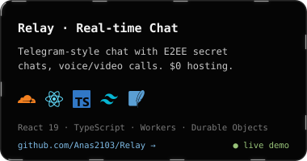
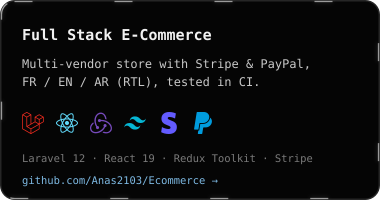
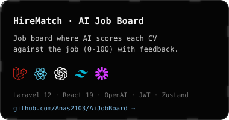
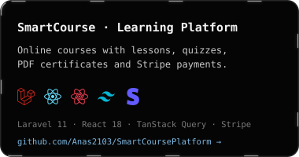
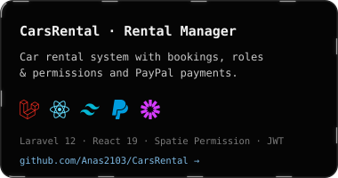
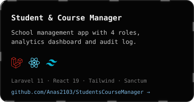

  

## Hi, I'm Hardouch Anas

Full stack developer. I build things for the fun of it. I use NixOS btw

**currently:** playing with nix flakes

### Featured projects

<!-- projects:start -->

  
  

  
  

  
  

live demos: [Relay · Real-time Chat](https://relay-chat.bunbunchat.workers.dev) · [Full Stack E-Commerce](https://anas2103-ecommerce.vercel.app)
<!-- projects:end -->

### GitHub stats

### Contact

